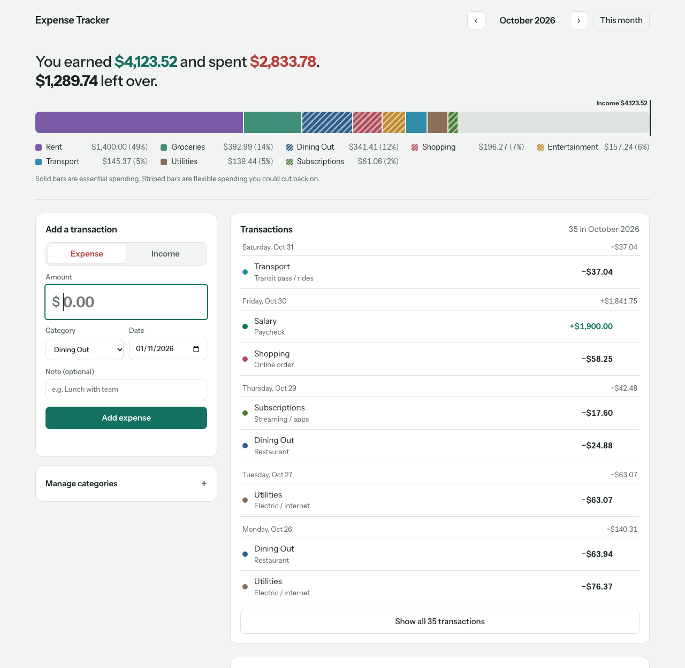

# Expense Tracker

A full-stack personal finance app for logging income and expenses by category, with a live analytics dashboard and an AI suggestion engine that recommends where to cut non-essential spending.

**Stack:** Next.js 15 (App Router) · React 19 · Node.js · MongoDB · REST APIs · Recharts · Ollama or OpenAI · JavaScript



## Features

- **Income and expense logging** with dates, notes and user-defined categories
- **Essential vs. non-essential categories.** Essential spending, like rent, is never targeted by AI suggestions
- **Month at a glance:** a one-sentence summary ("You earned $X and spent $Y. $Z left over.") above a single bar of spending split by category and measured against income. Essential spending is solid and flexible spending is striped
- **Fast logging:** large amount field, keyboard-friendly form, and a confirmation after every entry so you can log several in a row
- **Transactions grouped by day** with daily net totals, plus a day-by-day income and spending chart
- **MCP server:** Claude Code (or any MCP client) can read your spending and log expenses in plain English. See [MCP server](#mcp-server)
- **Live updates:** the dashboard refreshes after every change, every 15 seconds, and when the tab regains focus. The selected month is kept in the URL (`?month=2026-10`)
- **AI savings suggestions:** analyzes the last 3 months of spending and returns up to 3 concrete, category-level recommendations with estimated monthly savings. It runs on a **free local model through Ollama** by default, so spending data never leaves your machine, or on OpenAI with one setting

## Architecture

```
app/
  page.js                    Dashboard (client component)
  api/
    categories/              GET, POST       /api/categories
    categories/[id]/         DELETE          /api/categories/:id
    transactions/            GET, POST       /api/transactions?month=YYYY-MM
    transactions/[id]/       DELETE          /api/transactions/:id
    analytics/               GET             /api/analytics?month=YYYY-MM
    suggestions/             POST            /api/suggestions   { month }
components/                  Dashboard panels (form, list, charts, categories, suggestions)
lib/
  validation.js              Request validation (pure, unit tested)
  analytics.js               Monthly summary builder (pure, unit tested)
  suggestions.js             Spending profile, LLM prompt, output validation (pure, unit tested)
  llm.js                     Provider-neutral LLM call (Ollama or OpenAI, same Chat Completions format)
  transactions.js            Create-transaction rules shared by the REST API and the MCP server
  mongodb.js                 Cached MongoDB connection + indexes
mcp/
  server.js                  MCP server (stdio): 5 tools over the same MongoDB data
  smoke-test.js              End-to-end test: real MCP client calls every tool
scripts/seed.js              Demo data: 10 categories, 3 months of transactions
tests/                       node:test unit tests
```

## Design decisions

- **Money is stored as integer cents**, so totals never pick up floating-point errors like `0.1 + 0.2`.
- **The LLM handles judgment; code handles facts.** The model only picks which categories to cut and writes the advice. Every number the user sees, like "Averaged $234.48/month over Aug–Oct", is computed from real data. Early testing with a small local model showed it inventing figures and months, so its own numbers are discarded.
- **LLM output is validated, not trusted.** `parseSuggestions` drops suggestions for categories that don't exist (hallucinations), are marked essential or would save nothing, removes duplicates, and clamps each savings estimate to what the user actually spends in that category.
- **Out-of-date responses are ignored.** If you switch months quickly, a slow response for the previous month can't overwrite the month you're viewing.
- **Business logic is kept out of route handlers.** Validation, analytics and prompt building are pure functions, so they're tested without a database or network.
- **Data integrity is enforced in the API.** A transaction's type must match its category's kind; category names are unique per kind (case-insensitive index); a category that still has transactions can't be deleted.
- **The LLM provider is configuration, not code.** Ollama and OpenAI both speak the Chat Completions format, so `AI_PROVIDER` switches between them. The OpenAI key is never sent to any other provider.
- **It degrades gracefully.** Every AI failure the user can fix themselves gets a specific message: Ollama not running, model not downloaded, bad key, no credits, rate limits. A MongoDB outage returns a clear 503.

## Getting started

Requirements: Node.js 20+ and MongoDB (local or Atlas).

```bash
npm install
cp .env.example .env.local     # then edit .env.local
npm run seed                   # optional demo data (npm run seed -- --reset to wipe and reseed)
npm run dev                    # http://localhost:3000
```

On macOS, you can install and start MongoDB locally with:

```bash
brew tap mongodb/brew && brew install mongodb-community
brew services start mongodb-community
```

For free local AI suggestions, install Ollama and download the default model:

```bash
brew install ollama && brew services start ollama
ollama pull llama3.2:3b
```

### Environment variables

| Variable | Default | Purpose |
|---|---|---|
| `MONGODB_URI` | `mongodb://127.0.0.1:27017` | MongoDB connection string |
| `MONGODB_DB` | `expense_tracker` | Database name |
| `AI_PROVIDER` | `openai` if a key is set, else `ollama` | Which LLM generates savings ideas |
| `OLLAMA_MODEL` | `llama3.2:3b` | Local model used with Ollama |
| `OLLAMA_BASE_URL` | `http://localhost:11434/v1` | Ollama server address |
| `OPENAI_API_KEY` | none | Required only for `AI_PROVIDER=openai` |
| `OPENAI_MODEL` | `gpt-5-mini` | Model used with OpenAI |

## MCP server

The app includes a [Model Context Protocol](https://modelcontextprotocol.io) server, so an AI assistant can answer questions like *"Where did my money go in October?"* or handle *"Log $18 for lunch under Dining Out"* directly against your data.

| Tool | What it does | Writes data? |
|---|---|---|
| `list_categories` | All categories, with the essential flag | No |
| `get_month_summary` | Income, spending, net, and spending by category for a month | No |
| `list_transactions` | A month's transactions, filterable by category or type | No |
| `get_spending_trends` | Per-category totals and averages over the last N months | No |
| `add_transaction` | Logs an income or expense under an existing category | Yes |

**Using it with Claude Code:** the repo's `.mcp.json` registers the server automatically. Run `claude` in this folder and approve `expense-tracker` when prompted. To use it from any folder:

```bash
claude mcp add expense-tracker --scope user -- node "$(pwd)/mcp/server.js"
```

**Safety by design**

- **No delete tool.** An assistant can add data but can't remove it; deletion stays in the web UI.
- **Same rules as the web app.** `add_transaction` goes through the shared `createTransaction`, so the amount, date and category checks are identical.
- **Read-only tools are annotated** (`readOnlyHint`), so clients can auto-approve reads and ask before writes.
- **Helpful errors:** a wrong category name returns the list of valid ones, so the assistant can correct itself.

Run the end-to-end check, which uses a throwaway database:

```bash
npm run mcp:smoke
```

## Tests

```bash
npm test
```

24 unit tests (`npm test`) cover input validation (amounts, impossible dates, month ranges), the analytics summary, the AI-output guards (hallucinated categories, essential categories, invented numbers, zero or out-of-range savings, malformed JSON), and provider selection.

## Built with Claude Code

This project was built by directing Claude Code as the coding agent: I wrote the requirements, reviewed the generated code, and tested the result.

<!-- TODO(Akshay): replace with your own notes — 2-3 concrete moments, e.g.
- What I asked the agent for and what it produced
- Something I caught in review and changed (and why)
- A test I defined to check the agent's work
-->
